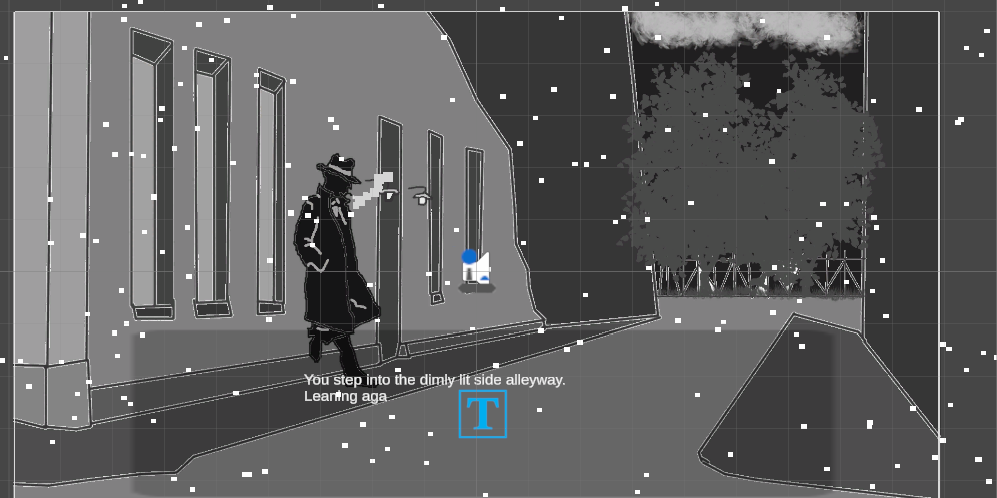
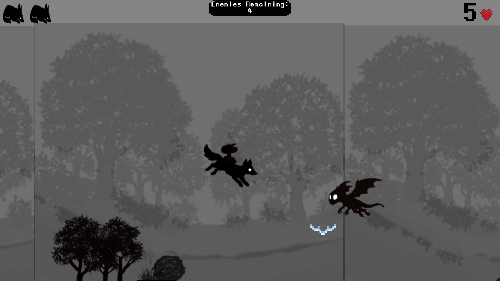
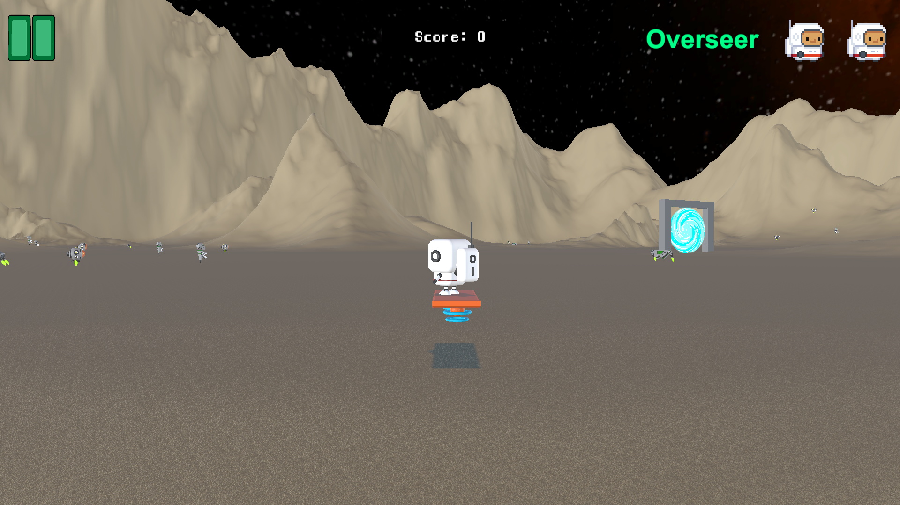

  <!-- Sticky Left Column -->
  <aside class="sidebar">
    <h1>Dakota Johnson</h1>
    Where code meets art.

    <!-- Quick Page Jump Links -->
    <nav class="jump-nav">
      <a href="#about">#about</a>
      <a href="#projects">#projects</a>
      <a href="#skills">#skills</a>
    </nav>

    <!-- External & Contact Links -->
    <nav class="external-links">
      <a href="https://tackytac.itch.io" target="_blank">itch.io &rarr; tackytac</a>
      <a href="https://github.com/DRyanJohnson" target="_blank">github &rarr; DRyanJohnson</a>
      <a href="https://www.linkedin.com/in/dryanjohnson/" target="_blank">linkedin &rarr; /in/dryanjohnson</a>
      <a href="./DJohnson.Resume.2026.pdf" target="_blank">resume.pdf</a>
      <a href="mailto:DRyanJohnson@outlook.com">DRyanJohnson@outlook.com</a>
    </nav>

    

      
<strong style="color: #95d5b2;">LANGUAGES:</strong> Java, C#, Bash, HTML/CSS

      
<strong style="color: #95d5b2;">3D &amp; 2D ART:</strong> Blender, Krita

      
<strong style="color: #95d5b2;">ENGINES &amp; IDEs:</strong> Unity, GitHub, JetBrains (Rider, IntelliJ IDEA, WebStorm), VS Code, Eclipse

    

  </aside>

  <!-- Right Main Feed -->
  <main class="content">

    <!-- About Me Section -->
    <section id="about" class="about">
      About Me
      

        I’m currently a junior studying Computer Science and Systems at the University of Washington Tacoma (with a minor in Technical Communication) after completing my foundational programming coursework at Tacoma Community College. My studies focus on object-oriented programming, software logic, and computer systems. In my free time, I build indie games in Unity using C# for scripting alongside my own 2D and 3D art created in Krita and Blender. I also use Bash for basic scripting, file management, and checking networks. Right now, I’m looking to connect with other developers and find software engineering internship opportunities where I can keep building my technical skills.
      

    </section>

    Projects

    <!-- Project 1 -->
    <article class="project">
      

        
      

      

        <h3>Never Made It</h3>
        C# / Unity 6 &bull; Krita 2D Art &bull; UWT Fall 2026 Game Jam
        

          A solo built visual novel developed in Unity 6 and C# for the UWT Fall 2026 Game Jam. I built a 17-scene narrative system via a custom StorySceneController, complete with a main menu, scrolling environmental sign text, a snowfall, smoke particle effect and synchronized background music and audio cues. I also created and formatted all 1920×1080 2D art assets in Krita and shipped a playable WebGL build to itch.io within the jam timeframe.
        

        

          <a href="https://tackytac.itch.io/never-made-it" target="_blank">Play on itch.io</a>
          <a href="https://github.com/DRyanJohnson/Never-Made-It-Game-C-unity-" target="_blank">View Code on GitHub</a>
        

      

    </article>

    <!-- Project 2 -->
    <article class="project flip">
      

        
      

      

        <h3>Fox Descend</h3>
        C# / Unity &bull; Custom 2D Sprites
        

          A 2D action shooter built in Unity and C# within a strict two-week course deadline. I scripted 2D combat and projectile mechanics for both the player and enemy types, handling trajectories, speed, and hit detection, alongside a level-progression system that unlocks the exit trigger only after all enemies are defeated. I also built a real-time HUD kill counter with Unity UI and created and animated custom 2D sprites for the player, enemies, and environments, which taught me how to scope and ship a complete WebGL build under a tight schedule.
        

        

          <a href="https://tackytac.itch.io/fox-descend" target="_blank">Play on itch.io</a>
          <a href="https://github.com/DRyanJohnson/Game-code/tree/main/FoxDescend" target="_blank">View Code on GitHub</a>
        

      

    </article>

    <!-- Project 3 -->
    <article class="project">
      

        
      

      

        <h3>Hoverboard &amp; Robots</h3>
        C# / Unity &bull; Blender 3D Models
        

          A 3D "HoverBoard"-action game built in Unity and C# within a three-week course deadline. I created a custom hoverboard controller and manager system supporting WASD movement, mouse-based rotation, mounting and dismounting toggles, and synchronized respawn logic tied to player health. To support seamless state transitions between on-foot and mounted modes, I refactored core player locomotion, camera tracking, and health scripts, and programmed state-based enemy AI that shifts targeting priority from the player to the hoverboard when mounted. Building out the 3D environment props and dynamic controls UI reinforced clean state management across multiple interacting scripts.
        

        

          <a href="https://tackytac.itch.io/hoverboard-robots" target="_blank">Play on itch.io</a>
          <a href="https://github.com/DRyanJohnson/Game-code/tree/main/Hoverboard%26Robots" target="_blank">View Code on GitHub</a>
        

      

    </article>

    <!-- Project 4 -->
    <article class="project flip">
      

        
      

      

        <h3>Farm Simulator</h3>
        Java &bull; OOP &amp; Collections
        

          A team-built, command-line farming simulation game built in Java using object-oriented classes (<code>Acre</code>, <code>Fish</code>) and collections (<code>HashMap</code>, <code>TreeMap</code>, <code>ArrayList</code>). Players buy land plots, plant and harvest 14 seasonal crops across four seasons, fish for extra gold, build fences against overnight wildlife attacks, apply fertilizer, and manage daily action points and yearly taxes. Coordinating multiple daily game systems and collaborating in a four-person team taught me how to structure game state cleanly and handle invalid user input without crashing the loop.
        

        

          <a href="https://github.com/DRyanJohnson/Farm-Simulator-Java" target="_blank">View Source Code on GitHub</a>
        

      

    </article>

    <!-- Skills Section -->
    <section id="skills" class="skills-footer">
      Skills &amp; Toolkit
      
<strong style="color: #95d5b2;">Languages:</strong> Java, C#, Bash, HTML/CSS

      
<strong style="color: #95d5b2;">Engines &amp; Dev Tools:</strong> Unity, GitHub, VS Code, Eclipse IDE, JetBrains (IntelliJ IDEA, Rider, WebStorm)

      
<strong style="color: #95d5b2;">Art &amp; 3D Modeling:</strong> Krita, Blender

    </section>

  </main>

## Resume & Contact

| Resume | Contact |
| :--- | :--- |
| 📄 **[View / Download Resume (PDF)](./DJohnson.Resume.2026.pdf)** | **Email:** [DRyanJohnson@outlook.com](mailto:DRyanJohnson@outlook.com)
