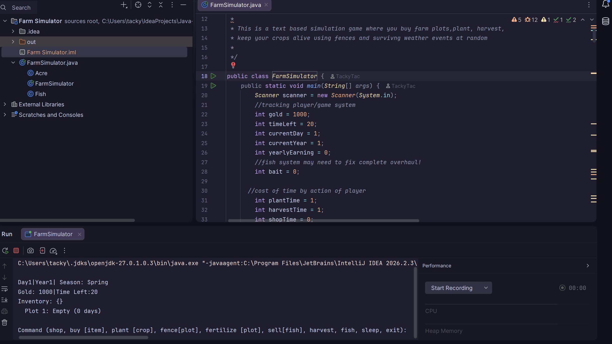

  <!-- Sticky Left Column -->
  <aside class="sidebar">
    <h1>Dakota Johnson</h1>
    Where code meets art.

    <!-- Quick Page Jump Links -->
    <nav class="jump-nav">
      <a href="#about">about</a>
      <a href="#projects">projects</a>
    </nav>

    <!-- External & Contact Links -->
    <nav class="external-links">
      <a href="https://tackytac.itch.io" target="_blank">itch.io</a>
      <a href="https://github.com/DRyanJohnson" target="_blank">github</a>
      <a href="https://www.linkedin.com/in/dryanjohnson/" target="_blank">linkedin</a>
      <a href="./DJohnson.Resume.2026.pdf" target="_blank">resume.pdf</a>
      <a href="mailto:DRyanJohnson@outlook.com">DRyanJohnson@outlook.com</a>
    </nav>

    

      
<strong style="color: #f4a261;">LANGUAGES:</strong> Java, C#, Bash, HTML/CSS

      
<strong style="color: #f4a261;">3D &amp; 2D ART:</strong> Blender, Krita

      
<strong style="color: #f4a261;">ENGINES &amp; IDEs:</strong> Unity, GitHub, JetBrains (Rider, IntelliJ IDEA, WebStorm), VS Code, Eclipse

    

  </aside>

  <!-- Right Main Feed -->
  <main class="content">

    <!-- About Me Section -->
    <section id="about" class="about">
      About Me
      

        I’m currently a junior studying Computer Science and Systems at the University of Washington Tacoma (with a minor in Technical Communication) after completing my foundational programming coursework at Tacoma Community College. My studies focus on object-oriented programming, software logic, and computer systems. In my free time, I build indie games in Unity using C# for scripting alongside my own 2D and 3D art created in Krita and Blender. I also use Bash for basic scripting, file management, and checking networks. Right now, I’m looking to connect with other developers and find software engineering internship opportunities where I can keep building my technical skills.
      

    </section>

    Projects

    <!-- Project 1 (Art Left, Text Right) -->
    <article class="project">
      

        
      

      

        <h3>Never Made It</h3>
        C# / Unity 6 &bull; Krita 2D Art &bull; UWT Fall 2026 Game Jam
        

          A 17-scene visual novel built solo in Unity 6 using C# launguage for a campus game jam. I structured branching dialogue with serializable <code>StoryBeat</code> and <code>ChoiceOption</code> classes using <code>enum</code> condition checks and state effects, tracked player strikes and inventory across scenes in a static <code>GameState</code> class, and used coroutines for typewriter text alongside custom 1920&times;1080 Krita art.
        

        

          <a href="https://tackytac.itch.io/never-made-it" target="_blank">Play on itch.io</a>
          <a href="https://github.com/DRyanJohnson/Never-Made-It-Game-C-unity-" target="_blank">View Code on GitHub</a>
        

      

    </article>

    <!-- Project 2 (Text Left, Art Right) -->
    <article class="project flip">
      

        
      

      

        <h3>Farm Simulator</h3>
        Java &bull; OOP &amp; Collections
        

          A command-line farming game built in Java with a four-person team. We used custom classes (<code>Acre</code>, <code>Fish</code>) and Java collections (<code>HashMap</code>, <code>TreeMap</code>, <code>ArrayList</code>) to track 14 seasonal crops, inventory, and daily actions, while handling input validation so bad console entries wouldn't crash the loop.
        

        

          <a href="https://github.com/DRyanJohnson/Farm-Simulator-Java" target="_blank">View Source Code on GitHub</a>
        

      

    </article>

    <!-- Project 3 (Art Left, Text Right) -->
    <article class="project">
      

        
      

      

        <h3>Hoverboard &amp; Robots</h3>
        C# / Unity &bull; Blender 3D Models
        

          A 3D action game created in Unity within a three-week deadline. I wrote a <code>HoverboardMountManager</code> that swaps between <code>CharacterController</code> movement and <code>Rigidbody</code> hoverboard physics, uses terrain height sampling to place the player safely on dismount, and pairs <code>NavMeshAgent</code> ground enemies with raycast sight-cone detection (<code>HoverbotSight</code>) alongside custom Blender 3D props.
        

        

          <a href="https://tackytac.itch.io/hoverboard-robots" target="_blank">Play on itch.io</a>
          <a href="https://github.com/DRyanJohnson/Game-code/tree/main/Hoverboard%26Robots" target="_blank">View Code on GitHub</a>
        

      

    </article>

    <!-- Project 4 (Text Left, Art Right) -->
    <article class="project flip">
      

        
      

      

        <h3>Fox Descend</h3>
        C# / Unity &bull; Custom 2D Sprites
        

          A 2D platformer shooter built in Unity and C# within a two-week deadline. I wrote a checkpoint-clamped <code>FlyingMonsterAI</code> state machine for patrolling and projectile attacks, implemented one-way pass-through platforms via <code>Physics2D.IgnoreLayerCollision</code>, and built key-gated doors with <code>UnityEvent</code> triggers, timed <code>DamageZone</code> hazards, and custom 2D sprites.
        

        

          <a href="https://tackytac.itch.io/fox-descend" target="_blank">Play on itch.io</a>
          <a href="https://github.com/DRyanJohnson/Game-code/tree/main/FoxDescend" target="_blank">View Code on GitHub</a>
        

      

    </article>

  </main>

